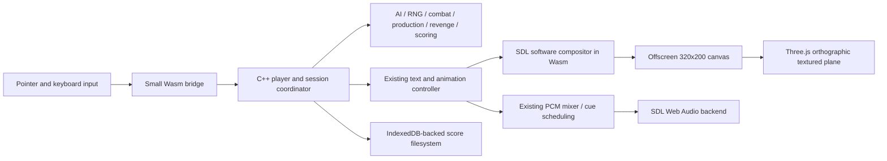

# Architecture

## Ownership

`wasm/include/nuclear` and `wasm/src/game` preserve the authoritative C++ model.
`wasm/src/ui/player_controller.cpp` coordinates original commands, resolved rounds,
committed HUD snapshots and death-triggered FIFO revenge. No equivalent algorithms
exist in TypeScript. Revenge still prefers eligible already-airborne bombers,
then missiles, with four attempts per eliminated player and survivor rotation.

`wasm/src/ui/turn_presentation.hpp` and `wasm/src/rendering` preserve sprites, speech,
typewriter, shutters, missile/bomber paths and special effects. Their original PNGs,
frame tables and bitmap font are compiled/loaded locally. No sprites are redrawn.

`wasm/src/platform/application.cpp` is the copied desktop frame loop with a narrow
web adapter: explicit Asyncify yield, SDL event injection, status observation,
existing audio mute access and a `/saves/HighScores` path. Asyncify preserves stack
locals across yields, so ordinary completion callbacks and elapsed-time clocks
are retained. The original renderer is selected as software and fixed at logical
320×200, rather than allocating a native 960×600 scaled window.

`src/rendering/GameRenderer.ts` owns a Three.js scene with an orthographic camera,
a single full-resolution textured plane and nearest sampling. The existing C++
compositor remains responsible for sprite layers and frame sequencing. This is
intentional: replacing every sprite path with duplicated TypeScript animation
code would increase parity risk. The adapter adds one canvas texture upload per
browser render frame. sRGB input/output avoids unintended color shifts; letterbox
bounds are shared with pointer coordinate conversion.

`src/input/InputManager.ts` forwards distinct pointer down/up/move and focus loss.
It does not interpret click versus hold: the existing C++ 200 ms gesture controller
still makes that decision. SDL's browser keyboard/text hooks handle the existing
keys and high-score name entry. The visible game canvas receives pointer capture.

`src/audio/AudioManager.ts` resumes SDL's module-owned Web Audio context after user
interaction and forwards mute to the original SoundManager, avoiding stale paused
PCM queues. The existing WAV decoder, rates, typewriter pulses and production
one-shot timing stay in C++. No JavaScript imitation audio or global time scale.

## Bridge API

`GameEngine.load` imports the local ES-module factory and initializes IndexedDB.
`start` invokes main once. C exports:

| Export | Purpose |
|---|---|
| `web_input(kind,x,y)` | Queue SDL motion(0), down(1), up(2), focus loss(3) in 320×200 coordinates |
| `web_status()` | Read-only JSON: screen, round, phase, selected count and presentation flags |
| `web_mute(value)` | Set the original audio manager's mute flag without changing cue clocks |
| `web_audio_muted()` | Observe audio mute state for UI/testing |

Commands are queued synchronously and consumed by the next frame. Status is an
observation, never another authoritative state. No mutable inventory is copied
into TypeScript. Save mounting completes before main and uses IDBFS autoPersist.
Fades/restart reset the existing session rather than constructing an alternate
web simulation. Errors from loading, C++ exceptions and Wasm aborts reach the page.
